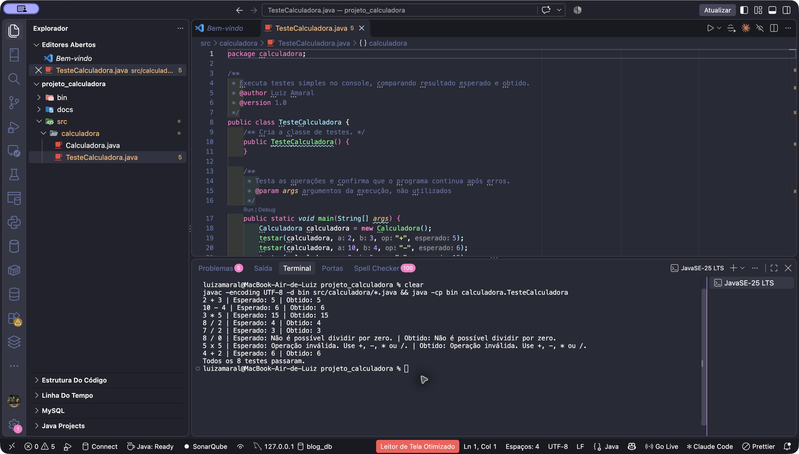
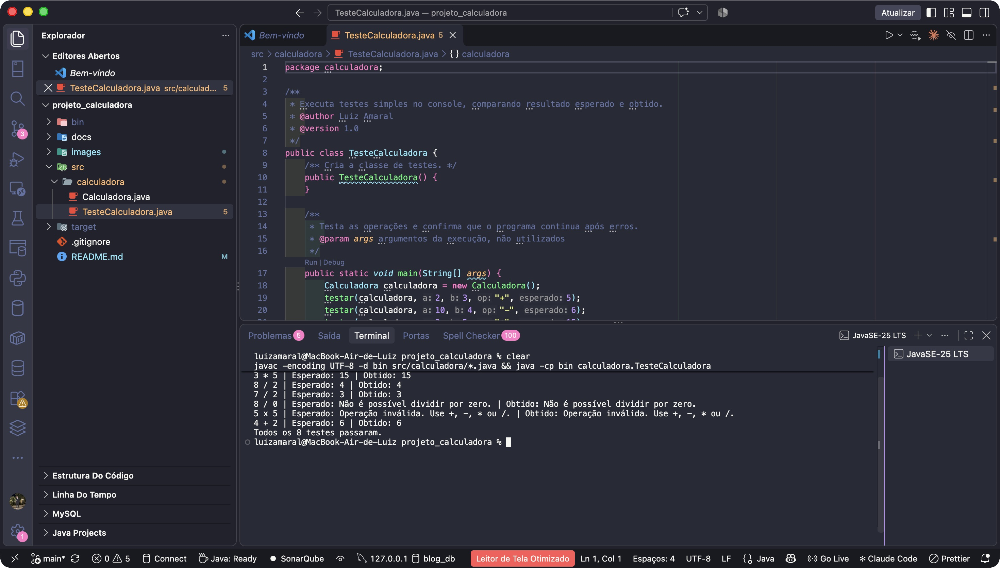
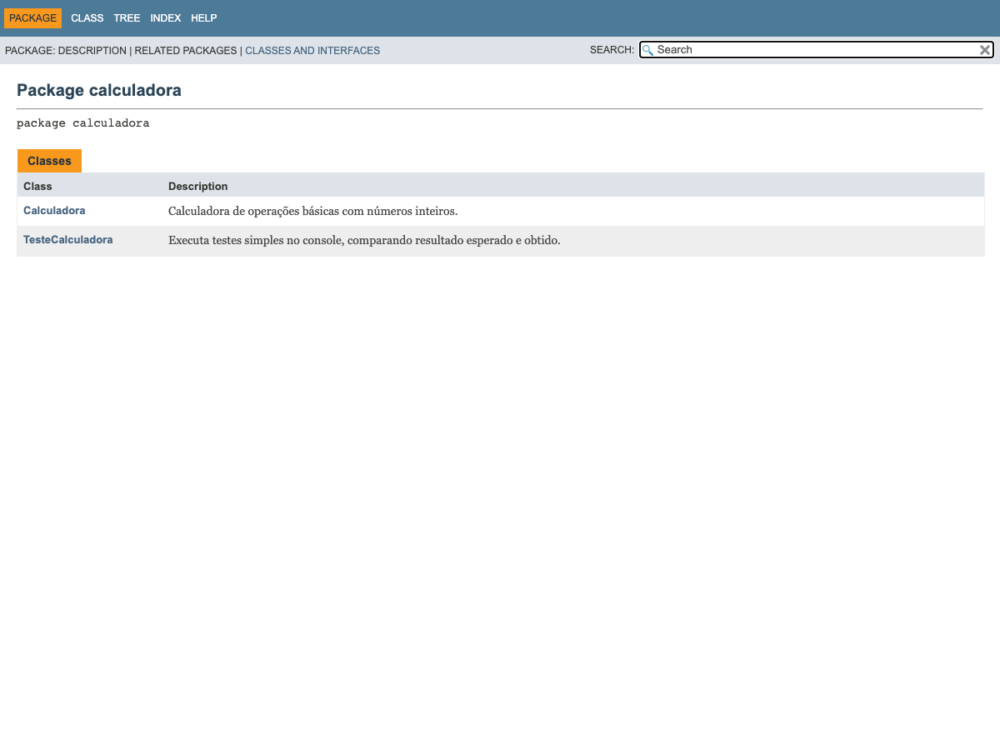
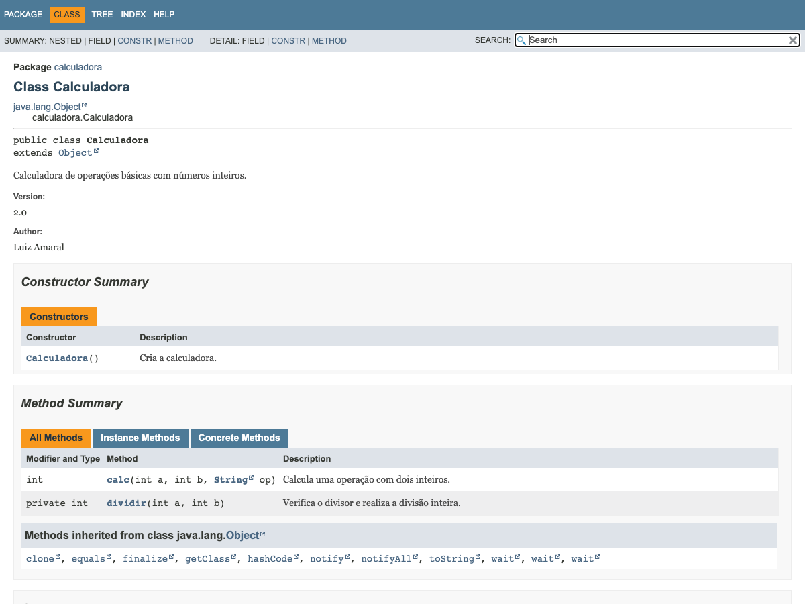

# Projeto Calculadora — FinançApp

> Projeto acadêmico desenvolvido com foco em Qualidade de Software, Testes, Refatoração, Documentação e Versionamento.

---

## 1. Identificação do Projeto

**Projeto:** Projeto Calculadora  
**Contexto:** FinançApp  
**Aluno:** Luiz Amaral  
**RA:** 251676  
**Curso:** Análise e Desenvolvimento de Sistemas  
**Disciplina:** AS406TSN4 - UX/UI e Testes de Software  
**Professor:** Ohata  
**Semestre:** 2026.2  

---

# 2. Visão Geral

O projeto consiste no desenvolvimento de um módulo de cálculos matemáticos básicos em Java para a startup fictícia **FinançApp**.

O módulo foi desenvolvido com o objetivo de ser utilizado futuramente em funcionalidades de controle financeiro, como:

- orçamento mensal;
- divisão de despesas;
- projeções financeiras;
- cálculos auxiliares.

Além do funcionamento correto das operações, o projeto aplica práticas de qualidade de software relacionadas a:

- testes;
- tratamento de erros;
- refatoração;
- documentação;
- versionamento;
- manutenção de código.

---

# 3. Problema

Durante o desenvolvimento da aplicação FinançApp, foi identificada a necessidade de criar um módulo matemático reutilizável.

Entretanto, a equipe definiu que o módulo não deveria apenas funcionar corretamente, mas também apresentar:

- código legível;
- testes automatizados;
- tratamento de falhas;
- documentação técnica;
- controle de versões;
- facilidade de manutenção.

O desafio consiste, portanto, em desenvolver uma solução funcional e ao mesmo tempo aplicar boas práticas de Engenharia de Software.

---

# 4. Objetivo

## 4.1 Objetivo Geral

Desenvolver uma calculadora em Java aplicando práticas de qualidade, testes, documentação, refatoração e versionamento.

## 4.2 Objetivos Técnicos

- implementar operações matemáticas básicas;
- tratar entradas inválidas;
- impedir divisão por zero;
- desenvolver testes automatizados;
- refatorar o código sem alterar seu comportamento;
- documentar classes e métodos com JavaDoc;
- gerar documentação HTML;
- utilizar Git e GitHub;
- organizar commits e branches;
- manter documentação técnica no README.

---

# 5. Escopo Funcional

A aplicação deverá oferecer as seguintes operações:

| ID | Funcionalidade | Descrição | Status |
|---|---|---|---|
| RF01 | Soma | Soma dois números inteiros | ✅ |
| RF02 | Subtração | Subtrai dois números inteiros | ✅ |
| RF03 | Multiplicação | Multiplica dois números inteiros | ✅ |
| RF04 | Divisão | Divide dois números inteiros | ✅ |
| RF05 | Validação de divisão | Impede divisão por zero | ✅ |
| RF06 | Operação inválida | Trata operadores não suportados | ✅ |

---

# 6. Requisitos Não Funcionais

| ID | Categoria | Requisito |
|---|---|---|
| RNF01 | Qualidade | O código deve possuir organização e legibilidade |
| RNF02 | Testabilidade | As operações devem possuir testes automatizados |
| RNF03 | Manutenção | O código deve permitir refatoração sem alteração funcional |
| RNF04 | Documentação | Classes e métodos devem possuir JavaDoc |
| RNF05 | Versionamento | O projeto deve utilizar Git e GitHub |
| RNF06 | Confiabilidade | Erros não devem interromper inesperadamente a execução |

---

# 7. Tecnologias Utilizadas

| Tecnologia | Versão | Utilização |
|---|---|---|
| Java | 17 | Desenvolvimento |
| JDK | 17.0.16 | Compilação |
| JUnit | Não utilizado | Testes feitos em Java, com `main`, `if` e `try/catch` |
| Git | 2.51.0 | Controle de versão |
| GitHub | — | Repositório remoto |
| JavaDoc | JDK 17 | Documentação |
| IDE | Visual Studio Code 1.143.1 | Ambiente de desenvolvimento e execução dos testes |

---

# 8. Estrutura do Projeto

```text
projeto_calculadora/
│
├── src/
│   └── calculadora/
│       ├── Calculadora.java
│       └── TesteCalculadora.java
│
├── docs/
│   └── index.html
│
├── images/
│   ├── testes/
│   └── javadoc/
│
├── README.md
└── .gitignore
```

As duas classes estão no pacote `calculadora`. Os testes não precisam de bibliotecas externas.

---

# 9. Como Executar

Com o JDK 17 ou superior instalado, abra a pasta do projeto no VS Code. No terminal integrado, execute:

```bash
javac -encoding UTF-8 -d bin src/calculadora/*.java
java -cp bin calculadora.TesteCalculadora
```

O método `calc(int a, int b, String op)` retorna um inteiro. Por exemplo, `7 / 2` retorna `3`.

---

# 10. Testes

Os oito testes verificam as quatro operações, divisão inteira, divisão por zero, operação inválida e uma soma após os erros. Cada teste compara entrada, resultado esperado e resultado obtido. Se houver diferença, a execução falha com `AssertionError`.

Os prints abaixo foram capturados no terminal integrado do VS Code, executando a versão inicial e a versão refatorada. As duas passaram nos oito testes e produziram a mesma saída.

## Antes da refatoração



## Depois da refatoração



---

# 11. Refatoração

Na versão inicial, a escolha das operações usava `if/else`. Na branch `Refatoracao`, foi usado `switch` e a divisão ficou no método `dividir`. Depois, os cálculos passaram a retornar o resultado diretamente.

Os testes foram executados novamente e a versão final foi integrada à `main`.

---

# 12. Documentação JavaDoc

Para gerar a documentação:

```bash
javadoc -private -encoding UTF-8 -charset UTF-8 -docencoding UTF-8 -author -version -d docs src/calculadora/*.java
```

Abra `docs/index.html` no navegador.





---

# 13. Repositório

- [Projeto no GitHub](https://github.com/lzAmaral/projeto_calculadora)
- [Branch principal](https://github.com/lzAmaral/projeto_calculadora/tree/main)
- [Branch Refatoracao](https://github.com/lzAmaral/projeto_calculadora/tree/Refatoracao)
- [Modelo do README da aula](https://github.com/dr-ohata/calculadora_refatoracao/blob/main/README.md)
