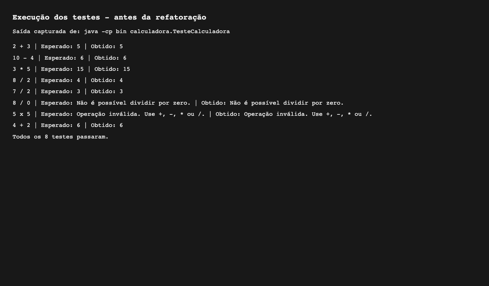
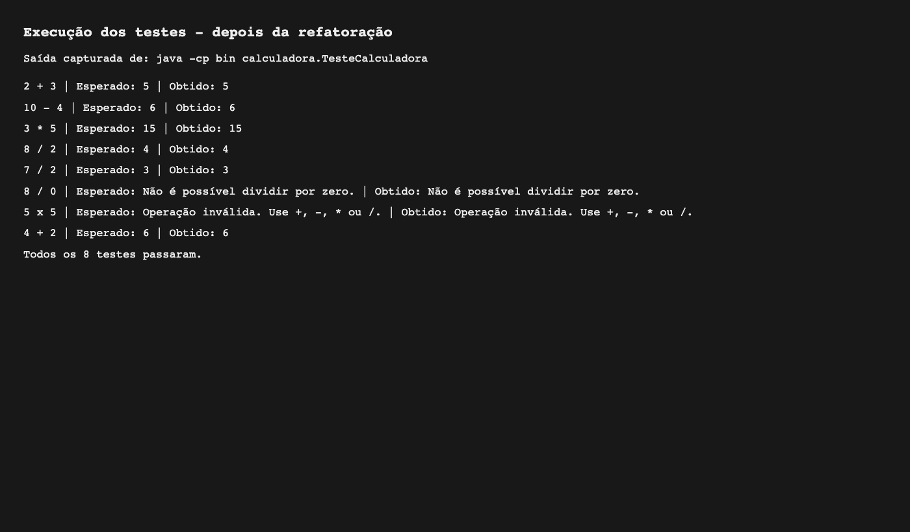
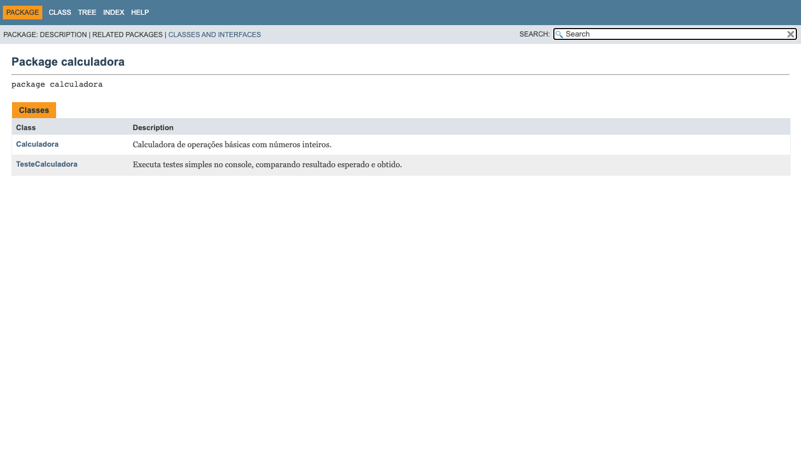
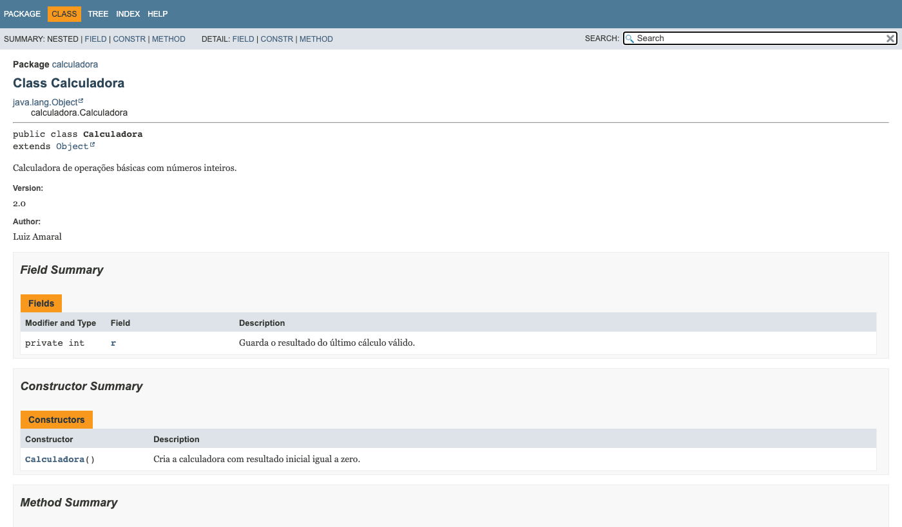

# Projeto Calculadora — FinançApp

Projeto acadêmico de Java para praticar testes, tratamento de erros, refatoração e documentação.

## 1. Identificação do Projeto

| Campo | Informação |
| --- | --- |
| Projeto | projeto_calculadora |
| Contexto | FinançApp |
| Aluno | Luiz Amaral |
| RA | 251676 |
| Curso | Análise e Desenvolvimento de Sistemas |
| Disciplina | AS406TSN4 - UX/UI e Testes de Software |
| Professor | Ohata |
| Semestre | 2026.2 |

## 2. Visão Geral

Calculadora simples com quatro operações básicas. No contexto da FinançApp, ela representa um módulo de cálculos que poderia ser usado no controle de finanças pessoais.

## 3. Problema

A FinançApp precisa realizar cálculos corretamente e tratar erros, como divisão por zero e operadores inválidos, sem encerrar o programa inesperadamente.

## 4. Objetivo

### 4.1 Objetivo Geral

Desenvolver uma calculadora em Java e praticar testes, refatoração, documentação e versionamento.

### 4.2 Objetivos Técnicos

- Implementar as quatro operações básicas.
- Tratar divisão por zero e operações inválidas.
- Comparar resultados esperados e obtidos nos testes.
- Refatorar e executar os mesmos testes novamente.
- Documentar o código com JavaDoc e gerar HTML.
- Organizar o projeto no GitHub.

## 5. Escopo Funcional

O método `calc(int a, int b, String op)` retorna um `int`. O atributo `r` guarda o último resultado válido, conforme o exemplo da aula.

| ID | Funcionalidade | Exemplo | Resultado |
| --- | --- | --- | --- |
| RF01 | Soma | `calc(2, 3, "+")` | 5 |
| RF02 | Subtração | `calc(10, 4, "-")` | 6 |
| RF03 | Multiplicação | `calc(3, 5, "*")` | 15 |
| RF04 | Divisão | `calc(8, 2, "/")` | 4 |
| RF05 | Divisão por zero | `calc(8, 0, "/")` | Mensagem de erro |
| RF06 | Operação inválida | `calc(5, 5, "x")` | Mensagem de erro |

A divisão é inteira: `7 / 2` retorna `3`. Os cálculos usam o tipo `int` do Java.

Para os erros, a calculadora lança `IllegalArgumentException`. A classe de testes usa `try/catch` para mostrar a mensagem e continuar a execução.

## 6. Requisitos Não Funcionais

| ID | Categoria | Como foi atendido |
| --- | --- | --- |
| RNF01 | Qualidade | Código simples e indentado |
| RNF02 | Testabilidade | Testes automáticos com comparação de resultados |
| RNF03 | Manutenção | Refatoração com repetição dos testes |
| RNF04 | Documentação | Comentários e JavaDoc |
| RNF05 | Versionamento | GitHub com main e Refatoracao |
| RNF06 | Confiabilidade | Tratamento dos erros previstos |

## 7. Tecnologias Utilizadas

| Tecnologia | Versão | Utilização |
| --- | --- | --- |
| Java / JDK | 17 | Compilar e executar |
| JavaDoc | JDK 17 | Gerar documentação HTML |
| Git | 2 | Controle de versões |
| GitHub | Serviço web | Repositório remoto |
| Terminal | — | Execução dos comandos e testes |

Os testes usam `main`, `if` e `try/catch`, seguindo a abordagem dos slides. Não é necessário instalar bibliotecas.

## 8. Estrutura do Projeto

```text
projeto_calculadora/
├── src/calculadora/
│   ├── Calculadora.java
│   └── TesteCalculadora.java
├── docs/
│   └── index.html
├── images/
│   ├── testes/
│   └── javadoc/
├── .gitignore
└── README.md
```

## 9. Como Executar

Instale o JDK 17 ou superior. Na pasta do projeto, execute:

```bash
javac -encoding UTF-8 -d bin src/calculadora/*.java
java -cp bin calculadora.TesteCalculadora
```

O programa executa oito testes: as quatro operações, divisão inteira, divisão por zero, operador inválido e uma soma após os erros. Cada teste mostra entrada, resultado esperado e resultado obtido. Se houver diferença, lança `AssertionError` e a execução termina com falha.

## 10. Testes e Prints

Os oito testes passaram antes e depois da refatoração. As imagens abaixo apresentam a saída real capturada da execução, exibida em uma página para facilitar a leitura.

### Antes da refatoração



### Depois da refatoração



## 11. Refatoração

A implementação simples inicial está no commit `ed29dfb`, com `if/else` e a divisão dentro de `calc`.

Na branch `Refatoracao`, a seleção das operações passou a usar `switch` e a divisão foi extraída para o método `dividir`. Os mesmos oito testes foram executados novamente e produziram as mesmas saídas.

A versão final também foi integrada à `main`. O histórico anterior foi preservado.

## 12. Documentação JavaDoc

Para gerar novamente a documentação:

```bash
javadoc -private -encoding UTF-8 -charset UTF-8 -docencoding UTF-8 -author -version -d docs src/calculadora/*.java
```

Depois, abra `docs/index.html` no navegador. A opção `-private` inclui a documentação do atributo `r` e dos métodos auxiliares.





## 13. Repositório

- [Projeto no GitHub](https://github.com/lzAmaral/projeto_calculadora)
- [Branch Refatoracao](https://github.com/lzAmaral/projeto_calculadora/tree/Refatoracao)
- [Modelo de README da aula](https://github.com/dr-ohata/calculadora_refatoracao)
